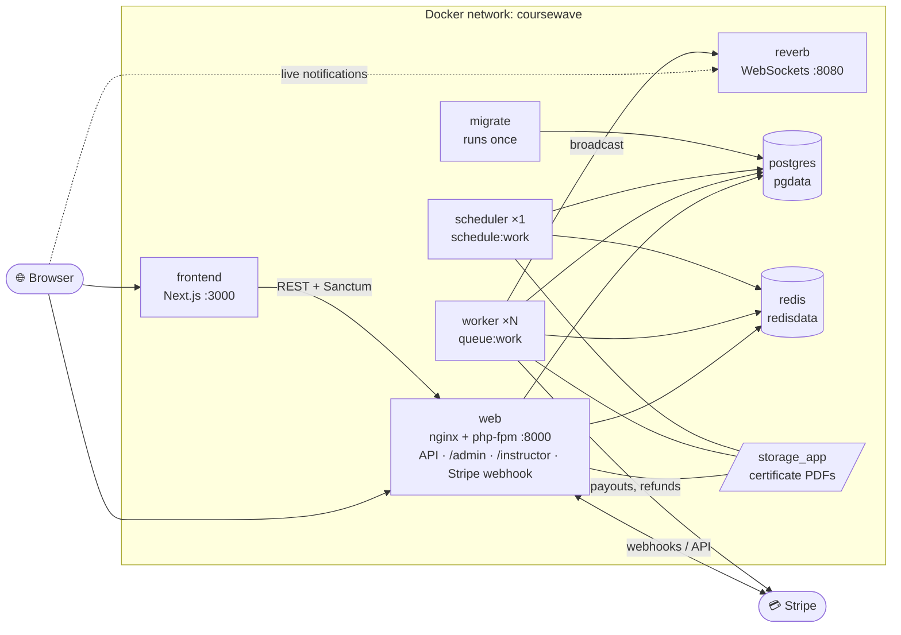
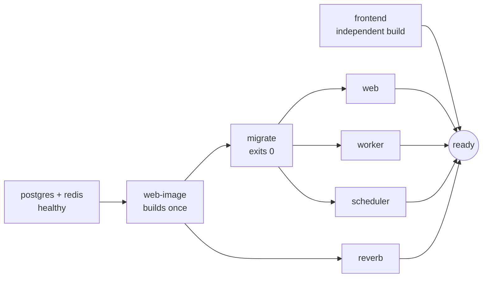

<div align="center">

# 🐳 CourseWave on Docker

**A subscription learning platform with a payout engine, running as 9 containers from a single command.**


[Choose your path](#-choose-your-path) ·
[Architecture](#-architecture) ·
[Part 1: Dev / Demo](#-part-1--dev--demo) ·
[Part 2: Production](#-part-2--production) ·
[Reference](#-reference) ·
[Troubleshooting](#-troubleshooting) ·
[Design decisions](#-engineering-decisions)

</div>

---

## 📖 What this document is

CourseWave is a learning platform where students pay once and the money is split fairly among the instructors they actually learned from. Payouts go through Stripe. This page explains **how to run the whole system with Docker**, either as a **demo** with realistic data or as a **clean production-style** deployment.

You do not need to be a Docker expert. If you can open PowerShell and paste commands, you can run it.

### ✨ What you get

| | |
|---|---|
| 🧱 **One image, five roles** | API, queue worker, scheduler, WebSocket server and migrations all run from the same image. An environment variable picks the role. |
| 🔐 **Secrets generated for you** | A script creates `.env` with random passwords and keys. Nothing is hard-coded. |
| 🛡️ **Two modes that cannot be confused** | Production refuses to run demo seeders. Demo mode refuses to be mistaken for production. |
| ⏱️ **Safe scheduling** | Exactly one scheduler container, so money jobs never run twice. |
| 🩺 **Health checks and a smoke test** | One command checks containers, endpoints, database, Redis, queue and seed data. |
| 🔁 **Self-ordering startup** | Migrations finish first, then everything else starts. |

---

## 🧭 Choose your path

| I want to... | Go to | Command |
|---|---|---|
| 🎬 **See the app with realistic data** (review, demo, development) | [Part 1: Dev / Demo](#-part-1--dev--demo) | `.\scripts\setup.ps1 -Mode demo` |
| 🚀 **Run a clean, production-style stack** | [Part 2: Production](#-part-2--production) | `.\scripts\setup.ps1 -Mode production -AdminEmail you@example.com` |
| 🧪 **Run the PHPUnit test suite** | [Part 1, section 1.5](#15-run-the-automated-tests-phpunit) | `cd apps/api` then `php artisan test` |
| ✅ **Check that a running stack is healthy** | Part 1 or Part 2, "Test it" | `.\scripts\smoke-test.ps1` |

> ⚠️ **Pick one mode per database.** Demo mode creates accounts with weak, public passwords. Never run it on a public server or with live Stripe keys. To switch modes later, add `-Reset` (it asks before deleting anything).

### Requirements (both parts)

- **Docker Desktop** with Compose v2 (`docker compose version` should print a version)
- **PowerShell** (built into Windows)
- About **6 GB free RAM** and **8 GB free disk** for the first build
- PHP and Node are **not** needed on your machine for Docker. (PHP is needed only to run PHPUnit.)

---

## 🗺️ Architecture



### Startup order



Nothing that needs the database starts until migrations have finished successfully. That removes a whole class of "it works on the second try" bugs.

### Services

| Service | What it does | Host port |
|---|---|---|
| `postgres` | PostgreSQL 17, with partitioned ledger tables | none |
| `redis` | Cache, queue and sessions | none |
| `web-image` | Builds the shared API image once, then exits | none |
| `migrate` | Runs `php artisan migrate --force` once, then exits | none |
| `web` | nginx + php-fpm: REST API, Filament admin and instructor panels, Stripe webhook | `127.0.0.1:8000` |
| `worker` | Queue workers (`QUEUE_WORKERS`, default 2): notifications, certificate PDFs, live-session fan-out | none |
| `scheduler` | Revenue recognition, weekly payouts, reconciliation, partitions, reminders. **Exactly one.** | none |
| `reverb` | Laravel Reverb WebSocket server for live notifications | `127.0.0.1:8080` |
| `frontend` | Next.js student app | `127.0.0.1:3000` |

All host ports are bound to `127.0.0.1`, so nothing is exposed to your network by accident.

### Repository files used by Docker

```
.
├── docker-compose.yml          # the stack (production settings)
├── docker-compose.demo.yml     # overlay: switches the API to APP_ENV=local for demo data
├── docker-compose.prod.yml     # overlay: Caddy reverse proxy + automatic HTTPS
├── .env.example                # every setting, documented (the real .env is never committed)
├── deploy/Caddyfile            # HTTPS routing used by the prod overlay
├── scripts/
│   ├── init-env.ps1            # creates .env and generates every secret
│   ├── setup.ps1               # start + seed, in one command, for either mode
│   └── smoke-test.ps1          # end-to-end health check for either mode
└── apps/
    ├── api/                    # Laravel: Dockerfile, docker/{nginx,php,supervisor}, entrypoint
    └── web/                    # Next.js: Dockerfile, .dockerignore
```

---

# 🎬 Part 1 · Dev / Demo

**Goal:** run the whole platform with realistic data so you can click through every screen.
**Mode flag:** `-Mode demo` · **Environment:** `APP_ENV=local` · **Data:** fake, with weak passwords

## 1.1 Quick start (one command)

```powershell
.\scripts\setup.ps1 -Mode demo
```

This one command:

1. creates `.env` with fresh random secrets (if it does not exist yet)
2. builds the images and starts all containers
3. waits until the API is healthy (migrations run automatically)
4. seeds roles, permissions, plans, 4 instructors, 8 courses, live sessions and 40 students with about 95 days of activity
5. **stops the scheduler on purpose**, so the seeded demo refunds and payouts are never sent to Stripe
6. prints your URLs and logins

The first build takes several minutes. Later runs take seconds.

## 1.2 Open it

| What | URL |
|---|---|
| 🎓 Student app | http://localhost:3000 |
| 🛠️ Admin panel | http://localhost:8000/admin |
| 👩‍🏫 Instructor panel | http://localhost:8000/instructor |
| ❤️ API health | http://localhost:8000/api/plans |

### Demo logins

| Who | Email | Password |
|---|---|---|
| Admin | `admin@llm.com` | `admin@12334` |
| Instructor (owns most demo data) | `instructor@llm.com` | `instructor@12334` |
| Student | `student@llm.com` | `student@12334` |
| Other instructors | `instructor1@llm.com` … `instructor3@llm.com` | `Password123` |
| 40 demo students | `demo.student01@llm.com` … `demo.student40@llm.com` | `Password123` |

## 1.3 What was seeded

| Seeder | Creates |
|---|---|
| `RoleSeeder` | `student`, `instructor`, `admin` roles |
| `shield:generate` ×2 | Filament permission rows (must run before the sync seeder) |
| `DatabaseSeeder` | `PlanSeeder`, `RolePermissionSyncSeeder`, `UserSeeder`, `CourseContentSeeder`, `LiveSessionSeeder` |
| `AnalyticsDemoSeeder` | 40 students, about 95 days of subscriptions, ledger entries, payouts, refunds (every state), certificates, comments, live sessions |

## 1.4 Test it (Dev / Demo)

**Automatic check**

```powershell
.\scripts\smoke-test.ps1 -Mode demo
```

Expected: every line says `PASS`, ending with `All checks passed. CourseWave is running correctly (demo).`

**Manual walkthrough (5 minutes)**

| # | Do this | You should see |
|---|---|---|
| 1 | Open http://localhost:8000/instructor and sign in as `instructor@llm.com` | A dashboard with six 7-day cards and a "needs attention" list |
| 2 | Open **Analytics** in the sidebar | Charts for earnings and learning hours, plus a course table |
| 3 | Open **Learners** | Students with progress (names only, never emails) |
| 4 | Sign out, then sign in at http://localhost:8000/admin as `admin@llm.com` | Alerts first (unconfirmed payouts and refunds), then revenue cards |
| 5 | Open http://localhost:3000 and sign in as `student@llm.com` | The course catalog and the learning pages |
| 6 | Trigger a live notification (command below) | The bell on the student app updates, with a toast popup |

```powershell
docker compose exec web php artisan notifications:test student@llm.com
```

**Check that background jobs work.** The scheduler is stopped in demo mode, so run jobs by hand:

```powershell
docker compose exec web php artisan recognition:run
docker compose exec web php artisan ledger:rebuild-balances
docker compose exec web php artisan certificates:sync
docker compose logs --tail=30 worker        # should show the jobs being processed, with no errors
```

## 1.5 Run the automated tests (PHPUnit)

PHPUnit runs **on your machine**, not inside Docker. The production image installs no dev dependencies and excludes `tests/` on purpose, to keep it small and safe.

```powershell
cd apps/api
php artisan test
```

## 1.6 Everyday dev commands

```powershell
docker compose logs -f web worker              # follow logs
docker compose exec web php artisan tinker     # open a shell into the app
docker compose restart worker                  # after changing an env var
docker compose start scheduler                 # let scheduled jobs run (calls Stripe test mode)
docker compose stop scheduler                  # protect the seeded demo data again
docker compose down                            # stop, keep data
```

## 1.7 Step by step (what `setup.ps1 -Mode demo` does)

Use this only if you want to understand or debug the script.

```powershell
# 1. create .env
.\scripts\init-env.ps1

# 2. build and start with the demo overlay
docker compose -f docker-compose.yml -f docker-compose.demo.yml up -d --build
docker compose ps        # migrate: Exited (0), the rest: Up / healthy

# 3. seed (once, in this order)
docker compose exec -u www-data web php artisan db:seed --class=RoleSeeder --force
docker compose exec -u www-data web php artisan shield:generate --panel=instructor --resource=CourseResource,LessonResource,QuizResource
docker compose exec -u www-data web php artisan shield:generate --panel=admin --resource=CourseResource,LessonResource,QuizResource,PlanResource
docker compose exec -u www-data web php artisan db:seed --force
docker compose exec -u www-data web php artisan db:seed --class=AnalyticsDemoSeeder --force

# 4. protect the demo refunds and payouts from the scheduler
docker compose stop scheduler
```

## 1.8 Reset or remove the demo

```powershell
.\scripts\setup.ps1 -Mode demo -Reset          # wipe everything and re-create the demo
docker compose down -v                         # stop and delete all data
```

---

# 🚀 Part 2 · Production

**Goal:** a clean, safe stack with no fake data and one real admin.
**Mode flag:** `-Mode production` · **Environment:** `APP_ENV=production` (forced by the compose file) · **Data:** only what is needed to start

Part 2 works on your own machine too (as a production rehearsal), and on a real server with HTTPS (section 2.6).

## 2.1 Before you start

| Check | Why |
|---|---|
| This database has **never** run demo mode | Demo data and weak passwords would remain. If it did, add `-Reset` |
| Stripe keys are in `apps/api/.env` or ready to paste into `.env` | Payments and payouts need them |
| You know the admin email you want | The admin is created for you; admins can never self-register |

## 2.2 Quick start (one command)

```powershell
.\scripts\setup.ps1 -Mode production -AdminEmail you@example.com -AdminName "Your Name"
```

This one command:

1. creates `.env` with fresh random secrets (if missing)
2. builds the images and starts all containers, with the scheduler **running**
3. waits until the API is healthy
4. seeds **only** roles, permissions and the three plans
5. creates one admin and **prints a generated password once, so save it**

There are no sample courses, no demo students and no default accounts.

## 2.3 What was seeded (and what was deliberately not)

| Seeded ✅ | Never seeded in production ❌ |
|---|---|
| `RoleSeeder` (3 roles) | `UserSeeder` (accounts with weak passwords) |
| `shield:generate` ×2 (permissions) | `CourseContentSeeder` (sample courses) |
| `PlanSeeder` (Monthly, 3-Month, Annual) | `LiveSessionSeeder` (sample sessions) |
| `RolePermissionSyncSeeder` (roles get permissions) | `AnalyticsDemoSeeder` (it refuses to run in production) |
| `coursewave:create-admin` (one admin) | A bare `php artisan db:seed` (it runs `UserSeeder`) |

> 🔴 **Never run a bare `php artisan db:seed` in production.** It would create `admin@llm.com` with a known password.

After sign-in, instructors and students register through the app, and instructors create their own courses in the instructor panel.

## 2.4 Test it (Production)

**Automatic check**

```powershell
.\scripts\smoke-test.ps1
```

Expected: every line says `PASS`, ending with `All checks passed. CourseWave is running correctly (production).` In this mode the check also confirms that **exactly one** scheduler is running.

**Safety checks (prove the production guards work)**

```powershell
# 1. The environment must be production
docker compose exec web printenv APP_ENV
#   expected: production

# 2. The demo seeder must refuse to run
docker compose exec web php artisan db:seed --class=AnalyticsDemoSeeder --force
#   expected: "AnalyticsDemoSeeder only runs when APP_ENV is local or testing."

# 3. No default weak accounts exist
docker compose exec web php artisan tinker --execute="echo \App\Models\User::where('email','admin@llm.com')->exists() ? 'EXISTS (bad)' : 'none (good)';"
#   expected: none (good)

# 4. The scheduler knows its jobs
docker compose exec web php artisan schedule:list
#   expected: recognition, payouts, refunds, certificates, live-session reminders, partitions
```

**Manual walkthrough (3 minutes)**

| # | Do this | You should see |
|---|---|---|
| 1 | Open http://localhost:8000/admin and sign in with the admin you created | An empty but working dashboard with "All clear" |
| 2 | Open **Plans** | Monthly, 3-Month and Annual |
| 3 | Open http://localhost:3000 and register a new student | Registration works and you land in the app |
| 4 | Watch the worker while you do this: `docker compose logs -f worker` | Jobs are processed, with no stack traces |

## 2.5 Run and maintain

```powershell
docker compose ps                                  # status of every container
docker compose logs --tail=100 scheduler           # confirm scheduled jobs ran
docker compose up -d --scale worker=3              # scale workers (NEVER scale the scheduler)
docker compose exec web php artisan coursewave:create-admin new@example.com --promote   # make an existing user an admin
```

**Deploy an update**

```powershell
git pull
docker compose up -d --build        # migrations run first, automatically
.\scripts\smoke-test.ps1
```

There is a short blip while `web` restarts (no zero-downtime yet). Workers finish their current job before stopping. To roll back: `git checkout <previous tag>`, then `docker compose up -d --build`. Migrations are not reversed automatically.

After adding a new Filament resource in future work, run `shield:generate` for it, then `RolePermissionSyncSeeder`.

**Backups.** PowerShell's `>` corrupts binary files, so dump inside the container and copy the file out:

```powershell
docker compose exec -T postgres sh -c "pg_dump -U coursewave -Fc coursewave > /tmp/backup.dump"
docker compose cp postgres:/tmp/backup.dump ./backups/coursewave-$(Get-Date -Format yyyyMMdd-HHmm).dump
```

Restore into an empty database:

```powershell
docker compose cp ./backups/FILE.dump postgres:/tmp/restore.dump
docker compose exec -T postgres sh -c "pg_restore -U coursewave -d coursewave --clean --if-exists /tmp/restore.dump"
```

Certificate PDFs live in the `storage_app` volume:

```powershell
docker run --rm -v coursewave_storage_app:/data -v ${PWD}/backups:/backup alpine tar czf /backup/storage-app.tgz -C /data .
```

## 2.6 Deploy on a server with HTTPS

Caddy adds automatic HTTPS certificates through Let's Encrypt.

1. **DNS and ports.** Point `APP_DOMAIN`, `API_DOMAIN` and `WS_DOMAIN` at the server, and open ports 80 and 443.
2. **Edit `.env`.** The frontend bakes these values in at build time, so the build must run *after* you set them:

   ```
   APP_URL=https://api.example.com
   FRONTEND_URL=https://app.example.com
   CORS_ALLOWED_ORIGINS=https://app.example.com
   PUBLIC_API_URL=https://api.example.com/api
   PUBLIC_REVERB_HOST=ws.example.com
   PUBLIC_REVERB_PORT=443
   PUBLIC_REVERB_SCHEME=https
   APP_DOMAIN=app.example.com
   API_DOMAIN=api.example.com
   WS_DOMAIN=ws.example.com
   ACME_EMAIL=you@example.com
   ```

3. **Trust the proxy.** In `apps/api/bootstrap/app.php`, inside `->withMiddleware(function (Middleware $middleware) { ... })`, add:

   ```php
   $middleware->trustProxies(at: '*');
   ```

4. **Start with the HTTPS overlay:**

   ```powershell
   docker compose -f docker-compose.yml -f docker-compose.prod.yml up -d --build
   ```

5. **Seed (production mode only):**

   ```powershell
   .\scripts\setup.ps1 -Mode production -NoBuild -AdminEmail you@example.com
   ```

6. **Stripe webhook.** In the Stripe dashboard, add the endpoint `https://<API_DOMAIN>/api/webhooks/stripe` and put its signing secret in `STRIPE_WEBHOOK_SECRET`, then run `docker compose up -d`.

   To test webhooks locally instead: `stripe listen --forward-to localhost:8000/api/webhooks/stripe`.

## 2.7 Step by step (what `setup.ps1 -Mode production` does)

```powershell
# 1. create .env
.\scripts\init-env.ps1

# 2. build and start
docker compose up -d --build
docker compose ps        # migrate: Exited (0), the rest: Up / healthy

# 3. seed (once, in this order)
docker compose exec -u www-data web php artisan db:seed --class=RoleSeeder --force
docker compose exec -u www-data web php artisan shield:generate --panel=instructor --resource=CourseResource,LessonResource,QuizResource
docker compose exec -u www-data web php artisan shield:generate --panel=admin --resource=CourseResource,LessonResource,QuizResource,PlanResource
docker compose exec -u www-data web php artisan db:seed --class=PlanSeeder --force
docker compose exec -u www-data web php artisan db:seed --class=RolePermissionSyncSeeder --force
docker compose exec -u www-data web php artisan coursewave:create-admin you@example.com --name="Your Name"
```

---

# 📚 Reference

## Dev vs Production at a glance

| | 🎬 Dev / Demo | 🚀 Production |
|---|---|---|
| Command | `setup.ps1 -Mode demo` | `setup.ps1 -Mode production` |
| Compose files | `docker-compose.yml` + `docker-compose.demo.yml` | `docker-compose.yml` (+ `docker-compose.prod.yml` for HTTPS) |
| `APP_ENV` / `APP_DEBUG` | `local` / `true` | `production` / `false` |
| Seed data | Full demo set | Roles, permissions, plans, one admin |
| Accounts | Known weak passwords | One admin with a generated password |
| Scheduler | **Stopped** (protects demo data) | **Running** (exactly one) |
| Dev tools (`/api/dev/*`, `notifications:test`, demo seeder) | Allowed | Blocked |
| Config caching | Off | On (built at container start) |
| Verify with | `smoke-test.ps1 -Mode demo` | `smoke-test.ps1` |
| Safe with live Stripe keys | ❌ Never | ✅ Yes |

## Seeder matrix

| Seeder | Creates | Dev / Demo | Production |
|---|---|:---:|:---:|
| `RoleSeeder` | `student`, `instructor`, `admin` roles | ✅ | ✅ |
| `shield:generate` ×2 | Filament permission rows | ✅ | ✅ |
| `PlanSeeder` | Monthly, 3-Month, Annual plans | ✅ (in `DatabaseSeeder`) | ✅ |
| `RolePermissionSyncSeeder` | Grants permissions to roles | ✅ (in `DatabaseSeeder`) | ✅ |
| `coursewave:create-admin` | One admin, generated password | n/a | ✅ |
| `UserSeeder` | Weak-password test accounts | ✅ (in `DatabaseSeeder`) | ❌ |
| `CourseContentSeeder` | 8 courses, lessons, quizzes, 4 instructors | ✅ (in `DatabaseSeeder`) | ❌ |
| `LiveSessionSeeder` | Sample live sessions | ✅ (in `DatabaseSeeder`) | ❌ |
| `AnalyticsDemoSeeder` | 40 students, about 95 days of history | ✅ | ❌ (refuses) |

## Key settings in `.env`

You normally never edit these by hand. `init-env.ps1` fills the secrets.

| Setting | Meaning |
|---|---|
| `APP_KEY`, `DB_PASSWORD`, `REDIS_PASSWORD`, `REVERB_APP_KEY`, `REVERB_APP_SECRET` | Generated secrets. Letters and digits only |
| `STRIPE_KEY`, `STRIPE_SECRET`, `STRIPE_WEBHOOK_SECRET` | Copied from `apps/api/.env` if present |
| `PLATFORM_FEE_PERCENT` | The platform's share of each recognized day (default 20) |
| `PAYOUT_MINIMUM_CENTS` | Smallest payout that will be sent (default 1000) |
| `QUEUE_WORKERS` | Worker processes per worker container (default 2) |
| `API_PORT`, `WEB_PORT`, `WS_PORT` | Host ports (defaults 8000, 3000, 8080) |
| `PUBLIC_*` | What the **browser** uses to reach the API and WebSockets. Changing them needs a frontend rebuild |

After changing `.env`, run `docker compose up -d`.

---

# 🩺 Troubleshooting

### Setup and build

| Symptom | Likely cause and fix |
|---|---|
| `required variable ... is missing` | Run `.\scripts\init-env.ps1` (or fill the variable in `.env`) |
| `pull access denied for coursewave-api` | The image is not built yet: `docker compose build web-image`, then `docker compose up -d` |
| `npm ci` says the lock file is out of sync | `docker run --rm -v "${PWD}/apps/web:/app" -w /app node:22-alpine npm install --package-lock-only`, then rebuild |
| `next build` fails on `useSearchParams` | Wrap that component in `<Suspense>` (see `app/(auth)/login/page.tsx`) |
| `--progress is a global compose flag` | Put it before the command: `docker compose --progress=plain build frontend` |
| `exec ... docker-entrypoint.sh: no such file or directory` | Windows line endings. Run `git add --renormalize .` and rebuild |
| Port already in use | Change `API_PORT`, `WEB_PORT` or `WS_PORT` (and the matching `PUBLIC_*`) |

### Database and seeding

| Symptom | Likely cause and fix |
|---|---|
| `migrate` exits non-zero | `docker compose logs migrate`. Often the volume was created with an older password: `docker compose down -v` (**destroys data**) |
| Redis auth errors | `REDIS_PASSWORD` must not be the word `null`. Run `init-env.ps1 -Force`, then `down -v` |
| `AnalyticsDemoSeeder only runs when APP_ENV is local` | You are in production mode. Use `.\scripts\setup.ps1 -Mode demo` |
| `shield:generate` ran but the sidebar is empty | Run `RolePermissionSyncSeeder` after it (the script does) |
| Demo data still visible after switching to production | The volume kept it. Run `.\scripts\setup.ps1 -Mode production -Reset` |
| `coursewave:create-admin` says the user exists | Add `--promote` to make that user an admin |

### Runtime

| Symptom | Likely cause and fix |
|---|---|
| Browser shows CORS errors | `CORS_ALLOWED_ORIGINS` must equal the exact Next.js origin; `docker compose restart web` |
| Filament page unstyled | `docker compose exec web php artisan filament:assets`, then hard reload |
| Notifications never arrive | `docker compose logs worker`; confirm `QUEUE_CONNECTION=redis` and that the worker is Up |
| No live toast but the bell updates | `docker compose logs reverb`; check `PUBLIC_REVERB_*` and rebuild the frontend |
| Certificate PDF stays "generating" | The worker is down, or `storage_app` is not mounted in `worker` |
| Scheduled job did not run | Only `scheduler` runs them, and it is stopped in demo mode: `docker compose logs scheduler` |

---

# ✅ Security checklist before real money

- [ ] Production mode only: `APP_ENV=production`, `APP_DEBUG=false`
- [ ] This database never ran `-Mode demo` or a bare `db:seed`
- [ ] Strong generated secrets, and `.env` is never committed
- [ ] Only Caddy (ports 80 and 443) is public; Postgres and Redis publish no ports
- [ ] Stripe **live** keys exist only in the server's `.env`
- [ ] A scheduled database backup exists, and one restore has been tested
- [ ] The payout reconciliation 23-hour resend guard is patched (see `PROJECT_STATE.md`, Known Issues)

---

# 🧠 Engineering decisions

Short notes on why the setup looks the way it does.

| Decision | Why |
|---|---|
| **One image, many roles** (`CONTAINER_ROLE`) | One build to test and ship. The web server, workers, scheduler and WebSocket server can never drift apart in version or dependencies |
| **`migrate` as a one-shot service** | Several replicas never race on migrations, and nothing starts against an old schema |
| **Exactly one scheduler** | Revenue recognition and payouts must run once. Two schedulers would run every money job twice |
| **Environment forced in compose** (`APP_ENV: production`) | A stray `APP_ENV=local` in `.env` can never reach production. Demo mode is a separate, explicit overlay |
| **Demo seeders refuse to run in production** | Fake ledger entries must never reach a database that handles real money |
| **Demo mode stops the scheduler** | Seeded refunds and payouts use fake provider IDs, and the scheduler would send them to Stripe |
| **Config is built at container start, not baked into the image** | The same image runs in every environment. No secret is ever stored in a layer |
| **`NEXT_PUBLIC_*` passed as build arguments** | Next.js inlines them into the JavaScript at build time. The docs say so plainly, so nobody wonders why a changed URL needs a rebuild |
| **Secrets generated, letters and digits only** | No weak or reused passwords, and no `$` that Compose would try to expand |
| **Ports bound to `127.0.0.1`** | Nothing is reachable from the network until Caddy is deliberately added |
| **Graceful shutdown** (`stop_grace_period`, `init: true`, direct `next start`) | Workers finish their current job and containers receive `SIGTERM`, so a deploy does not cut a payout in half |
| **PHPUnit outside the image** | The runtime image stays small and has no dev tooling |
| **A smoke test, not "it seems to work"** | One command checks containers, endpoints, database, Redis, the queue round trip and seed data, so anyone can verify a deployment the same way |