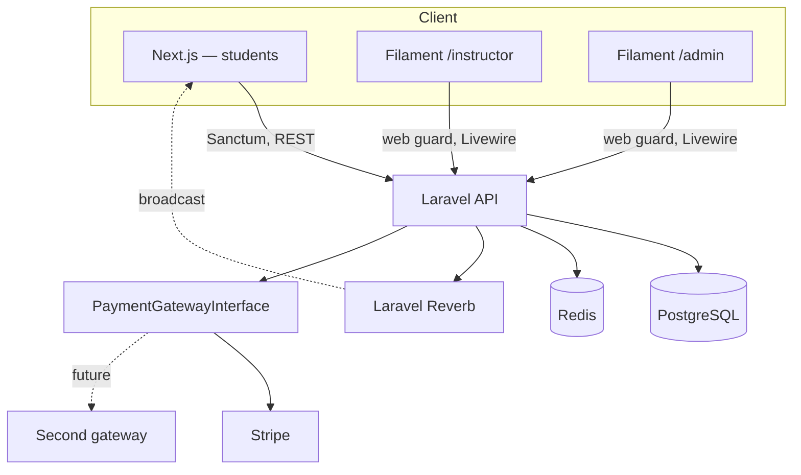
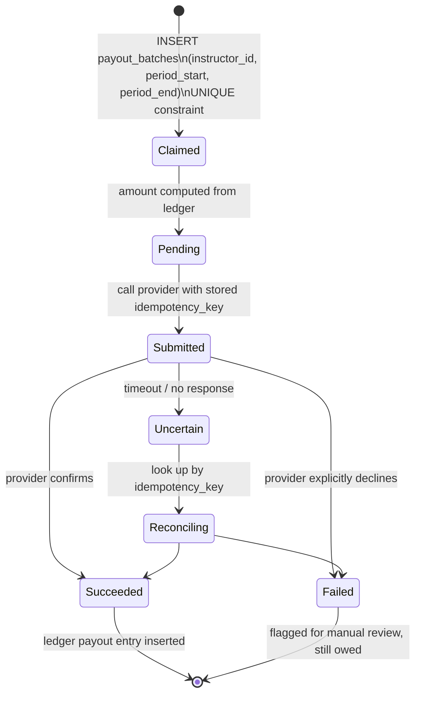

# 🎓 CourseWave — Subscription-Based Learning Platform (LMS)

> Students subscribe once and get access to every instructor's courses. Each subscription's revenue is split among the instructors a student actually learns from, paid out on a schedule through an external payment provider — accurately, exactly once, at 500K-subscription scale, even when the provider itself can't tell you if it worked.

---

## 📑 Contents

[Why This Project](#-why-this-project) · [Features](#-features) · [Tech Stack](#-tech-stack) · [Architecture](#-architecture) · [Payments & Payout Architecture](#-payments--payout-architecture-the-hard-part) · [Monorepo Layout](#-monorepo-layout) · [Roadmap](#-roadmap)

---

## 🎯 Why This Project

Most course-platform builds stop at "student pays, student watches." The actual hard problem here is financial: **one payment has to be divided, fairly and durably, among however many instructors a student's subscription touches** — and that division has to survive retried jobs, an unreliable payment provider, concurrent payout runs, and mid-term refunds, at a scale where "just recompute everything" isn't an option. Everything below is designed around that constraint first; the course-platform features are built on top of it, not the other way around.

## ✨ Features

| Area | What it does |
|---|---|
| **Subscriptions** | Monthly / 3-month / annual plans, paid in full up front, deferred-revenue recognition over the term (see Architecture). |
| **Catalog & content** | Courses → modules → lessons (video or text), instructor-managed via Filament, with attached resource links and quick quizzes per section. |
| **Progress tracking** | Per-lesson watch/read progress, course-level completion %, visible to the student, the instructor (per-student), and admin (platform-wide analytics). |
| **Comments** | Threaded comments on every lesson (video or text), replies included — the instructor's own replies are visually highlighted so students can tell who's answering. |
| **Certificates** | Auto-generated PDF certificate on course completion, with a verifiable certificate number. |
| **Notifications** | Persisted + live (Reverb) — new replies, live session reminders, certificate issued, payout processed — hybrid so nothing's missed if the recipient was offline. |
| **Live sessions** | Instructor attaches a Zoom/Meet link to a scheduled session; enrolled students are notified. |
| **Profiles** | Name, profile picture, email for every user — student, instructor, and admin. |
| **Instructor dashboard (Filament)** | Course/content CRUD, resource & quiz management, own-course analytics, own earnings/payout history. |
| **Admin dashboard (Filament)** | Every course, every student, every instructor, platform-wide analytics, manual payout controls, refund handling. |
| **Payouts** | Scheduled, idempotent, provider-agnostic (Stripe first, pluggable second gateway) — see below. |

## 💻 Tech Stack

| Layer | Choice |
|---|---|
| Student frontend | Next.js (App Router), TypeScript, Tailwind + shadcn/ui, TanStack Query, Zustand |
| Instructor + admin dashboards | **Filament** — two panels (`/instructor`, `/admin`) on one Laravel app, gated by spatie/laravel-permission via Filament Shield |
| Backend | Laravel, PHP 8.3+, Sanctum (student API), session/`web` guard (Filament panels) |
| Data | PostgreSQL (partitioned ledger/event tables — see Architecture), Redis (cache/queue/cart-equivalent) |
| Real-time | Laravel Reverb + Echo |
| Payments | Stripe first, behind a `PaymentGatewayInterface` so a second gateway is a new implementation, not a rewrite |
| PDF | Queued job, HTML → PDF, on lesson-completion event reaching 100% |
| Infra | Docker, nginx + php-fpm + supervisord (day-1 defaults — see the starter kit's Docker gotchas) |

## 🏗️ Architecture



Two client surfaces (Next.js for students, Filament for instructors/admin), one Laravel app, one payment abstraction so a second gateway is additive.

---

## 💰 Payments & Payout Architecture (the hard part)

### Design goals, restated as constraints

1. At any moment, answer **owed / paid / outstanding** per instructor — from a query, not a guess.
2. The payout process may run more than once, concurrently, from multiple servers. **No double payments, ever.**
3. The provider can succeed, fail, or go silent *after* moving money. The design must not assume either outcome on silence.
4. Background jobs crash and retry. Every step must be safe to re-run.
5. Refunds happen mid-term, after the student already paid for the whole term up front.
6. Money must divide evenly to the cent — no fractional cents, no drift.
7. 500K active subscriptions, tens of millions of records.

### 1. Money is integer cents, always

Every amount column is `bigint` cents (never float, never decimal-with-rounding-surprises). All division uses integer arithmetic with an explicit remainder-allocation step (§4) — there is never a "close enough" cent.

### 2. Don't recognize the whole payment as revenue on day one

This is the central decision. A student paying $120 for an annual plan hasn't "earned" any instructor $120 worth of value on day one — they've prepaid for a term they haven't consumed yet. So the payment is stored as **deferred revenue** and recognized incrementally:

- On subscription creation, the term is split into `term_days` **recognition slices**, each worth `total_amount_cents / term_days` (any leftover cents from integer division go on the final slice). All slices are created immediately, `status = pending`.
- A daily job advances each subscription's *current* slice from `pending` → `recognized`, and only a recognized slice becomes distributable to instructors.

This single decision is what makes refunds and idempotency both tractable — see §5 and §6.

### 3. Instructor split is consumption-weighted, per slice

"The instructors involved" means the instructors the student actually learned from *that day*, not every instructor on the platform. A lightweight, append-only `consumption_events` table logs watched-seconds (video) or read-completion (text) per `(subscription, student, instructor, lesson, date)`. When a slice recognizes:

1. Sum watched-seconds per instructor for that subscription on that date → weight per instructor.
2. Take the platform fee off the top: `platform_amount = floor(slice_cents × fee_percent)`, `instructor_pool = slice_cents − platform_amount` — exact, no drift.
3. Split `instructor_pool` by weight using the **largest-remainder method** (§4).
4. If there was *zero* consumption that day (student didn't engage with anything), the slice doesn't recognize to anyone — it stays `pending` and gets picked up together with the next day that *does* have activity, or resolved at term-end using the subscription's cumulative consumption share to date. If a student never engages with anything for an entire term, that revenue is retained as platform revenue — no instructor delivered value to attribute it to. This is a deliberate, stated business rule, not an oversight.

### 4. Splitting cents that don't divide evenly — the largest-remainder method

Given `instructor_pool` cents and N instructor weights:
```
raw_i    = instructor_pool × weight_i
floor_i  = floor(raw_i)
remainder = instructor_pool − Σ floor_i        # a small integer, always < N
```
Distribute `remainder` one cent at a time to the instructors with the largest fractional part (`raw_i − floor_i`), ties broken by `instructor_id` ascending for determinism. Every cent is accounted for; no instructor is arbitrarily favored run after run.

### 5. The ledger is the only source of truth — never a mutable balance

```
ledger_entries (append-only, partitioned by month on created_at)
  id
  instructor_id           nullable  -- null for platform_fee entries
  entry_type               enum(accrual, payout, refund_adjustment, platform_fee)
  amount_cents              bigint   -- +credit / −debit
  subscription_id           FK, nullable
  recognition_slice_id      FK, nullable
  payout_batch_id            FK, nullable
  idempotency_key            varchar UNIQUE   -- e.g. "accrual:{subscription_id}:{date}:{instructor_id}"
  created_at
```
**No `UPDATE` ever touches a money total.** Every accrual, payout, and adjustment is a new row. The unique `idempotency_key` means a daily recognition job — or a crashed-and-retried one, or two overlapping ones — can run the exact same insert twice and the second attempt simply no-ops (`ON CONFLICT DO NOTHING`) instead of double-crediting anyone. This is what makes "the job ran twice" a non-event rather than an incident.

**Answering the three required questions becomes pure aggregation:**
```sql
owed_cents       = SUM(amount_cents) WHERE entry_type='accrual'  AND instructor_id = ?
paid_cents       = SUM(amount_cents) WHERE entry_type='payout'   AND instructor_id = ?   -- always negative, stored as a debit
outstanding_cents = owed_cents + paid_cents
```
At scale, this aggregate is also maintained as a **derived, rebuildable projection** (`instructor_balances`, updated in the same transaction as each ledger insert) purely so a dashboard query doesn't scan tens of millions of rows — but the projection is never authoritative. If it ever drifts, it's rebuilt from the ledger, which is always correct by construction.

### 6. Payout runs: exactly-once under concurrency



- **Claiming a batch:** `payout_batches` has a `UNIQUE (instructor_id, period_start, period_end)` constraint. Two overlapping schedules, a manual re-trigger, or two servers racing all try to `INSERT` the same row — exactly one wins. This is the primary defense, not a distributed lock (locks alone aren't enough — they can expire mid-job); the database constraint is what actually can't be raced.
- **Computing the amount** happens once, at claim time, from the ledger — and is stored on the batch, not recomputed on retry.
- **Calling the provider** is a *separate* step from claiming, using a `gateway_idempotency_key` generated once at batch creation and persisted. Every retry of the provider call — whether from a crash, a timeout, or a queue retry — resends the *same* key. Stripe (and any competent gateway) dedupes on that key: a retried request either creates the transfer once or returns the original result, never a second transfer. This is the actual mechanism that makes "provider succeeded but we don't know" safe.
- **On timeout/no-response:** status goes to `uncertain`, never straight to `failed` and never assumed `succeeded`. A reconciliation job looks the transfer up by idempotency key against the provider before anything is marked final. Only a *confirmed* outcome writes the ledger `payout` entry — so "paid" can never be recorded speculatively.

### 7. Refunds mid-term

Because recognition only happens for days that have already elapsed (§2), a refund is simple by construction:

1. Void every `pending` (not-yet-recognized) slice for the subscription.
2. Refund the student `Σ voided slice amounts` via the provider, using an idempotency key derived from the subscription id (safe against duplicate refund requests too).
3. **No instructor clawback.** Every `accrual` ledger entry that already exists was for a slice that already recognized — meaning that day already elapsed and (if there was consumption) instructors already delivered value for it. Only money for days that *hadn't happened yet* gets refunded, and that money was never distributed to anyone in the first place.

### 8. Scale: 500K subscriptions, tens of millions of records

- `ledger_entries` and `consumption_events` are the two high-volume tables (500K subscriptions × ~365 slices/year × multiple instructors is comfortably in the tens-of-millions range) — both **partitioned by month** on their timestamp column, keeping indexes small and making old-partition archival trivial.
- Daily recognition runs as **chunked jobs** (`Subscription::query()->chunkById(1000, ...)`, one job per chunk), so a crash mid-run only needs to retry its own chunk — the unique idempotency keys make that retry safe regardless of chunk boundaries.
- Indexes: `ledger_entries (instructor_id, entry_type, created_at)` for balance aggregation; `consumption_events (subscription_id, event_date, instructor_id)` for daily weight computation.
- `instructor_balances` projection (§5) exists purely so dashboard reads don't aggregate the full ledger on every request.

---

## 📂 Monorepo Layout

```
CourseWave-monorepo/
├── apps/
│   ├── web/                      # Next.js — students only
│   └── api/                      # Laravel — API + both Filament panels
│       ├── app/
│       │   ├── Actions/                # Public API business logic
│       │   ├── Filament/
│       │   │   ├── Instructor/Resources/    # Course/lesson/quiz CRUD
│       │   │   └── Admin/Resources/          # Platform-wide oversight
│       │   ├── Domain/
│       │   │   ├── Billing/                  # Subscriptions, recognition, ledger, payouts
│       │   │   ├── Learning/                  # Courses, lessons, progress, comments
│       │   │   └── Certificates/
│       │   ├── Services/Payments/             # PaymentGatewayInterface + StripeGateway
│       │   ├── Models/
│       │   ├── Notifications/
│       │   └── Policies/
│       └── docker/
├── postman/
├── docker-compose.yml
├── .env.example
├── README.md
├── PROJECT_STATE.md
└── AI_SESSION_WORKFLOW.md
```

## 🗺️ Roadmap

See `PROJECT_STATE.md` → Next Steps for the full phase breakdown. In short: auth/profiles → course content (Filament) → subscription intake → consumption tracking → revenue recognition + ledger → payout runs + reconciliation → refunds → comments → certificates → notifications → live sessions → analytics → Docker.
