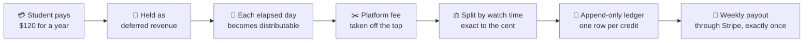
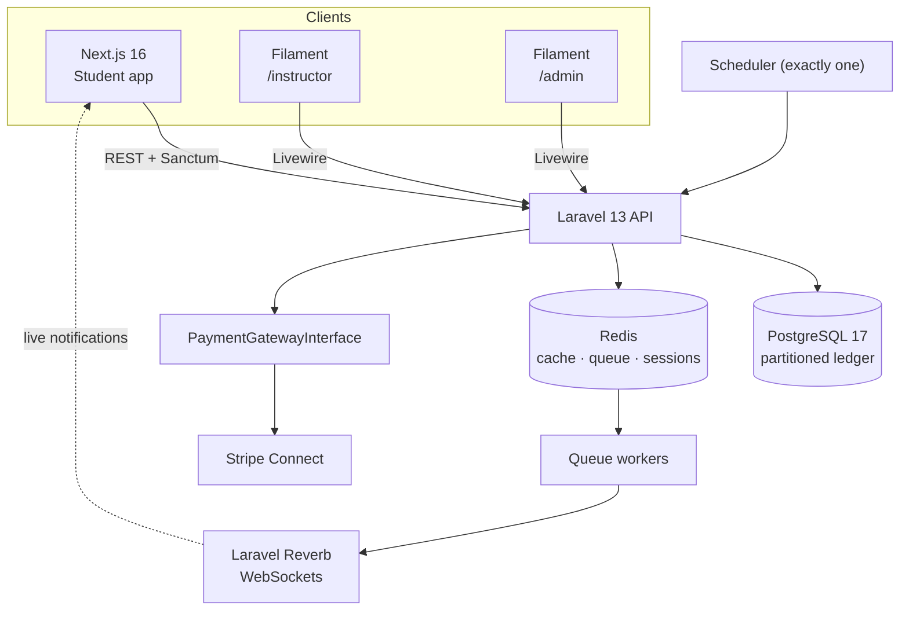

<div align="center">

# 🎓 CourseWave

### One subscription. Every instructor. Paid fairly, to the cent.

A full-stack learning platform where students subscribe once to access every course, and each payment is **split automatically among the instructors they actually learned from**, paid out through Stripe, accurately and exactly once.


[The problem](#-the-problem-it-solves) ·
[Features](#-features) ·
[How the money works](#-how-the-money-works) ·
[Architecture](#-architecture) ·
[Run it](#-run-it) ·
[What I built](#-what-i-built)

</div>

---

## 💡 The problem it solves

Most course platforms stop at "student pays, student watches." The hard part is what happens to the money.

| 🧑‍🎓 For students | 👩‍🏫 For instructors | 🏢 For the business |
|---|---|---|
| Pay once and learn from everyone, instead of buying course after course | Get paid for the value they actually delivered, not a flat guess | Know exactly what is owed, paid and outstanding at any moment |
| Cancel and get back only the days that have not happened yet | See their earnings, learners and payout history | Never pay the same person twice, even when servers crash and retry |
| Earn certificates anyone can verify | Reply to learners, run live sessions, track engagement | Refunds, payouts and revenue stay consistent, to the cent |

**The core question this project answers:** *when one payment must be divided among many instructors, how do you make it fair, exact, auditable and safe, even when jobs retry, servers run in parallel and the payment provider goes silent?*

---

## ✨ Features

### For students
- **Three plans** (monthly, 3-month, annual) with Stripe Checkout and plan switching
- **Courses, modules and lessons** in video or text, with resource links and quick quizzes
- **Progress tracking** per lesson and per course
- **Threaded discussions** on every lesson, with instructor replies highlighted
- **Verifiable PDF certificates** generated on course completion, with a public verification page
- **Live sessions** with a countdown and a join button that appears at the right moment
- **Real-time notifications** over WebSockets, saved when you are offline
- **Self-service cancellation** with a fair refund for unused days

### For instructors (Filament panel)
- Course, lesson, quiz and resource management
- **Dashboard** with a 7-day glance and a "needs attention" list
- **Analytics:** earnings, learners, learning hours, completions, per-course performance
- **Learners** page with per-student progress
- Earnings, ledger and payout history; Stripe payout account onboarding
- Schedule, edit and cancel live sessions; reply to comments

### For admins (Filament panel)
- Platform-wide **analytics**: revenue, growth, health, top instructors and courses
- **Alerts first:** unconfirmed or failed payouts and refunds, instructors owed money with no payout account
- Manual payout controls, refund handling, subscription and plan management

---

## 💰 How the money works

This is the heart of the project. In plain language:



| Idea | What it means | Why it matters |
|---|---|---|
| **Deferred revenue** | A year's payment is recognized day by day, never all on day one | Refunds become simple: only future days go back, and nobody is clawed back |
| **Consumption-weighted split** | Each day's money is divided among the instructors a student actually learned from | Fair pay that follows real value |
| **Largest-remainder method** | Cents that do not divide evenly are allocated deterministically | No fractional cents, no drift, every cent accounted for |
| **Append-only ledger** | Money is never edited, only added as new rows | A full audit trail; balances can be rebuilt from scratch at any time |
| **Idempotency keys** | Every money step carries a key stored in the database | A retried job or a crashed server cannot double-credit or double-pay |
| **"Uncertain" is a real state** | If the payment provider times out, the system neither assumes success nor failure | Money is only marked paid after the provider confirms it |
| **Database-enforced claims** | A unique constraint, not a lock, decides which server runs a payout | Two servers racing cannot both win |

The full design is in [`docs/PAYMENTS_DESIGN.md`](docs/PAYMENTS_DESIGN.md).

---

## 🏗️ Architecture



| Layer | Choice | Why |
|---|---|---|
| Student app | Next.js 16 (App Router), TypeScript, Tailwind, shadcn/ui, TanStack Query | Fast, typed, accessible, responsive UI in light and dark mode |
| Instructor and admin | Filament on the same Laravel app | Powerful dashboards without a second codebase |
| API | Laravel 13, PHP 8.4, Sanctum | Mature, testable, expressive domain code |
| Data | PostgreSQL (monthly partitions), Redis | Handles tens of millions of ledger rows; fast queues and cache |
| Real-time | Laravel Reverb and Echo | Live notifications without a third-party service |
| Payments | Stripe Connect behind `PaymentGatewayInterface` | A second gateway is a new class, not a rewrite |
| Infra | Docker Compose, nginx, php-fpm, supervisord, Caddy | One command to run the whole stack |

### Built to scale
Designed for **500K active subscriptions and tens of millions of records**: partitioned high-volume tables, chunked daily jobs where a crash only retries its own chunk, purpose-built indexes, and a rebuildable balance projection so dashboards never scan the whole ledger.

---

## 📂 Repository layout

```
.
├── apps/
│   ├── web/                 # Next.js student app            → apps/web/README.md
│   └── api/                 # Laravel API + both Filament panels → apps/api/README.md
├── scripts/                 # setup, env generation, smoke test (PowerShell)
├── deploy/                  # Caddy config for automatic HTTPS
├── docs/                    # Payments design document
├── docker-compose.yml       # The stack
├── docker-compose.demo.yml  # Demo overlay (sample data)
├── docker-compose.prod.yml  # HTTPS overlay (Caddy)
├── DOCKER.md                # Full run guide: demo and production
└── PROJECT_STATE.md         # Build log: every phase, decision and test
```

---

## 🚀 Run it

You need **Docker Desktop** and **PowerShell**. Nothing else.

```powershell
# See everything with realistic data (about 95 days of activity, 40 students)
.\scripts\setup.ps1 -Mode demo

# Verify it is healthy
.\scripts\smoke-test.ps1 -Mode demo
```

Then open:

| | |
|---|---|
| 🎓 Student app | http://localhost:3000 |
| 👩‍🏫 Instructor panel | http://localhost:8000/instructor |
| 🛠️ Admin panel | http://localhost:8000/admin |

Demo logins are printed by the setup script and listed in [`DOCKER.md`](DOCKER.md), which also covers a clean **production** setup, HTTPS, backups and troubleshooting.

---

## 🧱 What I built

The project was built in **13 phases**, each shipped with automated tests:

| # | Phase | Highlights |
|:-:|---|---|
| 1 | Auth, roles and panels | Registration, login, three roles, two Filament panels |
| 2 | Course content | Courses, modules, lessons, links, quizzes, public catalog |
| 3 | Subscriptions | Stripe Checkout, webhook-authoritative confirmation, plan switching |
| 4 | Consumption tracking | Watch and read heartbeats, quiz grading, learning UI |
| 5 | Revenue recognition and ledger | Daily recognition, largest-remainder split, partitioned ledger |
| 6 | Payouts | Exactly-once claims, reconciliation, Stripe Connect onboarding |
| 7 | Refunds | Cancel flow, idempotent provider calls, admin tools |
| 8 | Comments | Threaded discussions with instructor highlight |
| 9 | Certificates | PDF generation, public verification |
| 10 | Notifications | Persisted and live over WebSockets, in three surfaces |
| 11 | Live sessions | Scheduling, countdown, at-most-once reminders |
| 12 | Analytics | Instructor and admin dashboards, cached aggregates |
| 13 | Dockerization | One-command demo and production, smoke tests, HTTPS |

### By the numbers

| | |
|---|---|
| 🧪 Automated backend tests | **240+** across billing, payouts, refunds, notifications and analytics |
| 🐳 Containers | **9**, from one API image run in five roles |
| 👥 User roles | **3**: student, instructor, admin |
| 🔌 Money invariants | Exact to the cent · idempotent · auditable · rebuildable |

### Engineering highlights

- 🔒 **Safe by construction:** money moves only through idempotent, database-guarded steps, so retries are harmless.
- 🧩 **Provider-agnostic:** payments sit behind an interface, so Stripe can be swapped or joined by another gateway.
- 🛡️ **Ownership enforced twice:** every instructor-facing query is scoped and policy-checked.
- 📈 **Observable:** every provider call is logged in an append-only attempt log, and admins are alerted to anything unconfirmed.
- 🐳 **Reproducible:** demo and production are two explicit, separate modes, and a smoke test proves a deployment is healthy.

---

## 📚 More documentation

| Document | What it covers |
|---|---|
| [`DOCKER.md`](DOCKER.md) | Run guide for demo and production, backups, HTTPS |
| [`apps/web/README.md`](apps/web/README.md) | Frontend: structure, state, real-time, UX standards |
| [`apps/api/README.md`](apps/api/README.md) | Backend: domains, money engine, scheduler, tests |
| [`docs/PAYMENTS_DESIGN.md`](docs/PAYMENTS_DESIGN.md) | The payment and payout design in depth |
| [`PROJECT_STATE.md`](PROJECT_STATE.md) | The complete build log |

<div align="center">

Built by **George Antwan Hosny Ghaly;** · [LinkedIn](https://www.linkedin.com/in/georgeantwan/) · [Portfolio](https://georgeantwanhosny.github.io/portfolio/)

</div>