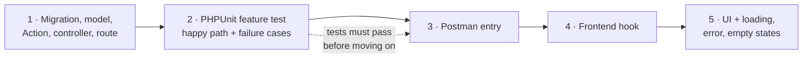

<div align="center">

# ⚙️ CourseWave API

**The Laravel backend: REST API, Filament dashboards, the revenue ledger and the payout engine.**


</div>

---

## 💡 What this service does

It is the system of record for everything that matters in CourseWave: who subscribed, what they learned, **which instructor earned how much**, and what has been paid. It exposes a REST API to the student app and hosts two Filament dashboards for instructors and admins.

**Business value:** the platform can answer *owed / paid / outstanding* for every instructor from a single query, and it can never pay the same person twice. The full money design is in [`docs/PAYMENTS_DESIGN.md`](../../docs/PAYMENTS_DESIGN.md).

---

## 🧠 The money engine

| Component | Responsibility |
|---|---|
| **Recognition slices** | A subscription is split into one slice per day, created up front. A daily job recognizes elapsed days only |
| **`LargestRemainderSplitter`** | Divides each day's instructor pool by watch time, in integer cents, with deterministic tie-breaking |
| **`ledger_entries`** | Append-only, partitioned by month. Entry types: `accrual`, `payout`, `refund_adjustment`, `platform_fee`. Unique `idempotency_key` per row |
| **`instructor_balances`** | A rebuildable projection for fast dashboards. Never authoritative (`ledger:rebuild-balances`) |
| **Payout batches** | Claimed by `INSERT` under a unique constraint, amount computed once, provider called with a stored idempotency key |
| **Reconciliation** | A provider timeout becomes `uncertain`, then is resolved by looking the transfer up |
| **Refunds** | Void only future `pending` slices and refund their sum. No instructor clawback by design |
| **Attempt logs** | Every provider call is recorded in an append-only log |

---

## 🧪 Testing: every feature ships with its tests

**Roughly 240 automated tests**, written **with each feature, before the next one starts**. Nothing in this project was built "and tested later".

### The workflow applied to every feature



The frontend work starts only when the backend step has a **passing test and a Postman entry**.

### What every feature's tests cover

| Always tested | Example |
|---|---|
| ✅ Happy path | A student completes the last lesson and a certificate is issued |
| ❌ Failure and validation | Invalid input returns the unified `{ success: false, errors }` envelope |
| 🔒 Authorization and ownership | An instructor cannot read another instructor's learners or earnings |
| ♻️ Idempotency and retries | Running recognition twice credits once; a repeated webhook changes nothing |
| 🧮 Money rules | Splits sum to the exact cent; refunds equal the sum of voided slices |
| 🔔 Side effects | The right people are notified, exactly once |

### Test suites by phase

| Phase | Area | Test classes | Tests |
|:-:|---|---|--:|
| 1 | Auth and roles | `AuthTest` | 7 |
| 2 | Course catalog | `CourseCatalogTest` | 4 |
| 3 | Subscriptions | `SubscriptionCheckoutTest`, `StripeWebhookTest`, `SubscriptionSwitchingTest` | 14 |
| 4 | Consumption and quizzes | `ConsumptionTrackingTest`, `QuizAttemptTest` | 16 |
| 5 | Revenue recognition and ledger | `RevenueRecognitionTest` | 10 |
| 6 | Payouts | `PayoutRunTest`, `PayoutAttemptLogTest`, `PayoutAccountOnboardingTest` | 20 |
| 7 | Refunds | `RefundTest` | 15 |
| 8 | Comments | `CommentTest` | 14 |
| 9 | Certificates | `CertificateTest`, `DevCertificateToolsTest` | 24 |
| 10 | Notifications | `NotificationApiTest`, `NotificationTriggersTest`, `NotificationAudienceTest`, `FilamentNotificationsTest` | 40 |
| 11 | Live sessions | `LiveSessionApiTest`, `LiveSessionActionsTest`, `LiveSessionRemindersTest`, `LiveSessionPolicyTest`, `LiveSessionModelTest` | 39 |
| 12 | Analytics and dashboards | `AnalyticsSupportTest`, `InstructorAnalyticsTest`, `PlatformAnalyticsTest`, `AnalyticsWidgetsTest`, `DashboardInsightsTest`, `DashboardWidgetsTest` | 38 |
| | **Total** | | **≈ 240** |

### Where to find them

```
apps/api/tests/
├── Feature/              # one class per feature, grouped by domain
│   └── Analytics/        # analytics services, widgets, dashboards
├── Concerns/             # shared fixtures as traits (never copy-pasted helpers)
└── Unit/                 # pure logic such as money and splitting
```

### Testing conventions

- **A test class per feature**, named for what it proves.
- **Model factories** build every fixture, so tests are short and readable.
- **Time is controlled** with `travelTo()` and explicit as-of dates, so tests never depend on the clock or hit a missing ledger partition.
- **Queues and notifications are faked** (`Queue::fake()`), so no test calls Stripe or a WebSocket server.
- **Filament widgets and pages are rendered** in tests, not just their services.
- **Table filters are exercised**, not only displayed.
- **Multi-user tests reset the auth guards** between requests.

### Running them

```bash
php artisan test                                   # everything
php artisan test --filter=RevenueRecognitionTest   # one class
php artisan test --filter=test_refund              # by name
php artisan test --parallel                        # faster
```

Tests run on your machine against the test database, not inside the runtime Docker image, which deliberately ships without dev tooling.

---

## 🧱 Code organization

```
apps/api/
├── app/
│   ├── Actions/                 # Business operations (one class, one job)
│   │   ├── Billing/             #   subscribe, recognize, claim/submit/finalize payouts, refunds
│   │   └── Learning/            #   progress, quizzes, certificates, live sessions
│   ├── Filament/
│   │   ├── Instructor/          #   resources, pages, widgets
│   │   └── Admin/               #   platform oversight
│   ├── Http/                    # Controllers, Form Requests, API Resources
│   ├── Services/
│   │   ├── Payments/            #   PaymentGatewayInterface + StripeGateway
│   │   └── Analytics/           #   instructor and platform analytics services
│   ├── Notifications/           # Stored and broadcast notifications
│   ├── Policies/                # Authorization
│   ├── Jobs/                    # Queued work
│   ├── Console/Commands/        # Scheduler and operations commands
│   └── Support/                 # ApiResponse, Money, SafeNotify, partition manager
├── database/                    # Migrations, factories, seeders
├── routes/                      # api.php, channels.php, console.php (schedule)
├── tests/                       # PHPUnit tests
└── docker/                      # nginx, php-fpm and supervisor configs
```

### Design patterns used

| Pattern | Where | Benefit |
|---|---|---|
| **Action classes** | `app/Actions/*` | Thin controllers; every business rule is testable on its own |
| **Gateway interface** | `PaymentGatewayInterface` | Swap or add a payment provider without touching domain code |
| **Unified response contract** | `ApiResponse` | Every endpoint returns `{ success, message, data, errors }` |
| **Policies and scopes** | `app/Policies`, model scopes | Ownership enforced at the query and authorization layers |
| **Service layer for analytics** | `Services/Analytics` | Widgets only format data; every figure is testable without the UI |
| **`SafeNotify`** | `app/Support` | A notification can never break the action that triggered it |

---

## 🔌 API at a glance

All responses use the same envelope:

```json
{ "success": true, "message": "...", "data": { }, "errors": null }
```

| Area | Examples |
|---|---|
| Auth | register, login, logout, current user (Sanctum tokens) |
| Catalog | `GET /api/plans`, public course catalog |
| Subscriptions | checkout session, plan switch, cancel |
| Learning | lessons, progress heartbeat, quiz attempts, comments |
| Certificates | list, download, public verification |
| Live sessions | `GET /api/learning/live-sessions` |
| Notifications | list, unread count, mark read, `POST /api/broadcasting/auth` |
| Webhooks | `POST /api/webhooks/stripe` (signature-verified) |

A ready-made Postman collection lives in `/postman`, with an entry for every endpoint.

---

## ⏱️ Scheduled jobs

| Job | When | Purpose |
|---|---|---|
| `recognition:run` | Daily 02:00 | Turn elapsed days into distributable revenue |
| `payouts:run` | Mondays 04:00 | Claim and submit instructor payout batches |
| `ledger:create-partitions` | Monthly, day 25 | Create next months' ledger partitions ahead of time |
| `refunds:dispatch-pending` | Every 10 min | Safety net for refunds stuck in `pending` |
| `certificates:sync` | Hourly | Backfill certificates and missing PDFs |
| `live-sessions:send-reminders` | Every minute | Send each reminder once |

Every job is safe to run twice, and the scheduler runs in exactly one container.

---

## 🗄️ Data design for scale

- `ledger_entries` and `consumption_events` are **partitioned by month**
- Daily recognition runs in **chunks of 1,000 subscriptions**, and a crash retries only its chunk
- Purpose-built **indexes** for balance aggregation, daily weights and analytics
- **Cached aggregates** (5 minutes; 60 seconds for attention figures)

---

## ▶️ Running it

**With Docker (recommended):** from the repo root, `.\scripts\setup.ps1 -Mode demo`. See [`../../DOCKER.md`](../../DOCKER.md).

**Locally (Laravel Herd or `artisan serve`):**

```bash
composer install
cp .env.example .env && php artisan key:generate
php artisan migrate
php artisan db:seed

php artisan serve                 # API and Filament panels
php artisan queue:work            # notifications, PDFs, live-session fan-out
php artisan reverb:start          # WebSocket server
php artisan schedule:work         # scheduled jobs
```

### Useful commands

```bash
php artisan recognition:run [--date=]
php artisan payouts:run [--date=] [--instructor=]
php artisan ledger:rebuild-balances         # rebuild the balance projection from the ledger
php artisan coursewave:create-admin you@example.com --name="You"
php artisan db:seed --class=AnalyticsDemoSeeder   # local/testing only
```

---

## 🔐 Security and safety

- Webhook signatures verified; admins can **never** self-register
- Provider-specific values stay inside the gateway class
- Developer tools and demo seeders **refuse to run in production**
- Certificate PDFs are stored privately; the public verification page exposes no email
- Join links for live sessions are revealed only inside the join window