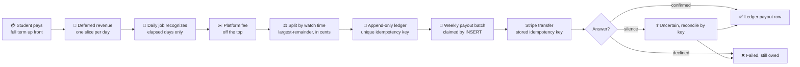
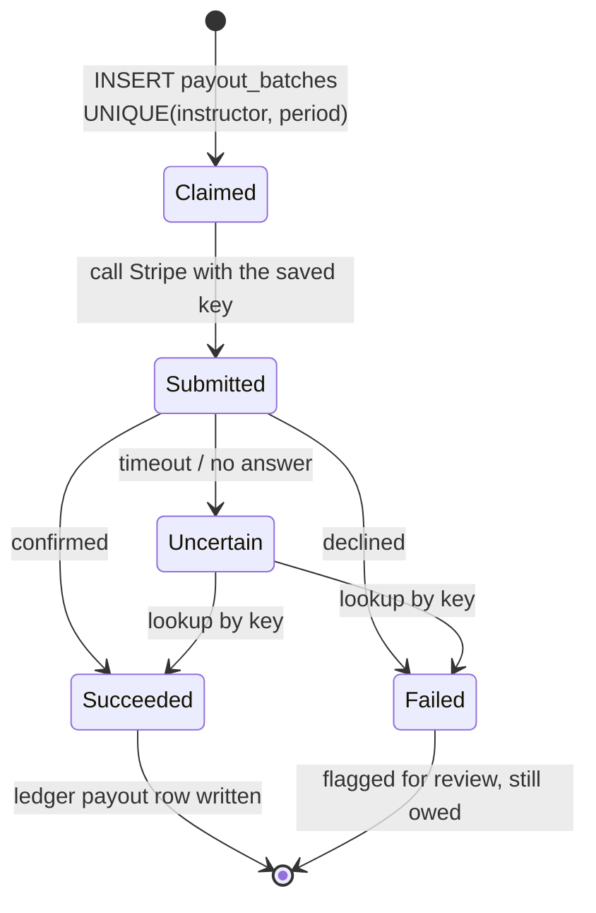

<div align="center">

# 💰 CourseWave Payments Design

**How one subscription payment is divided fairly among many instructors, paid out through Stripe, and kept exact to the cent, even when servers crash and the payment provider goes silent.**

</div>

---

## 1. The problem

A student pays **$120 for a year**. Over that year they learn from three different instructors. Four questions must always have a precise answer:

| Question | Why it is hard |
|---|---|
| **Who earned what?** | The money must follow real learning, not a flat guess |
| **What happens if the student cancels in month 3?** | Some days were delivered, others were not |
| **What if a payout job runs twice?** | Paying twice is real money lost |
| **What if Stripe never answers?** | Did the transfer happen or not? Guessing either way is wrong |

At scale (**500K subscriptions, tens of millions of ledger rows**) the answer cannot be "recompute everything and hope".

---

## 2. The design in one picture



---

## 3. Ten decisions that make it correct

| # | Decision | What it buys |
|--:|---|---|
| 1 | **Money is integer cents** (`bigint`), never floats | No rounding surprises, anywhere |
| 2 | **Deferred revenue:** the term is paid up front but recognized one day at a time | Refunds become simple, nobody is paid for days that have not happened |
| 3 | **Consumption-weighted split:** only instructors the student actually used that day share it | Pay follows real value |
| 4 | **Largest-remainder method** for uneven cents | Every cent allocated, deterministic, no drift |
| 5 | **Append-only ledger:** no `UPDATE` ever touches a money total | A complete audit trail |
| 6 | **Unique `idempotency_key` on every ledger row** | A rerun or crashed job inserts the same row twice and the second is a no-op |
| 7 | **Payout claimed by `INSERT`** under a unique constraint | Two servers racing cannot both win. A database constraint can't be raced; a lock can expire |
| 8 | **Provider key generated once**, saved, and resent on every retry | Stripe de-duplicates, so a retry can never pay twice |
| 9 | **"Uncertain" is its own state** | Silence is never assumed to be success or failure |
| 10 | **Balances are a rebuildable projection** | Dashboards are fast, and the ledger is always the truth |

---

## 4. A worked example

### Splitting one day

One day of a subscription is worth **$1.00** (100 cents). The platform fee is 20%. Three instructors each got **equal** watch time.

```
slice            = 100¢
platform fee     = floor(100 × 20%) = 20¢
instructor pool  = 100 − 20         = 80¢

equal weights → 80 ÷ 3 = 26.67¢ each
floor each           → 26 + 26 + 26 = 78¢
remainder            → 80 − 78      = 2¢

give 1¢ each to the largest fractional parts (all tied)
tie-break by instructor id, ascending:

  instructor #1 → 27¢
  instructor #2 → 27¢
  instructor #3 → 26¢      total = 80¢  ✅ not one cent lost or invented
```

### A day nobody studied

If no one engaged that day, the slice stays **pending** and is recognized together with the next day that has activity. If a student never engages for the whole term, that revenue stays with the platform, because no instructor delivered value to attribute it to.

### A mid-term cancellation

A student on a $30, 30-day plan cancels after 10 days have elapsed:

| Days | Status | Outcome |
|---|---|---|
| 1 to 10 | Already recognized | Instructors keep their accruals. **No clawback**, because they delivered value |
| 11 to 30 | Still pending | **Voided** and refunded: 20 days × $1.00 = **$20.00** |

The refund is the sum of exactly the voided slices, sent with the key `refund:{subscription_id}`, so a double-click cannot refund twice.

---

## 5. The ledger

```
ledger_entries   (append-only, partitioned by month)
  instructor_id        nullable (null for platform fees)
  entry_type           accrual | payout | refund_adjustment | platform_fee
  amount_cents         +credit / −debit
  subscription_id, recognition_slice_id, payout_batch_id
  idempotency_key      UNIQUE   e.g. accrual:{subscription}:{date}:{instructor}
  created_at           the economic date (deterministic, never wall-clock)
  recorded_at          when the row was inserted
```

The three numbers the business asks for are pure aggregation:

```
owed        = SUM(accrual)
paid        = SUM(payout)          (stored negative)
outstanding = owed + paid
```

`instructor_balances` holds these as a **projection** for fast dashboards. It moves only when a ledger row was actually inserted, and `ledger:rebuild-balances` can recreate it from the ledger alone at any time.

---

## 6. Paying instructors safely



- The **amount is computed once**, at claim time, from the ledger, and stored on the batch.
- The **payout ledger row is written only after Stripe confirms**, so "paid" is never recorded speculatively.
- Every provider call, successful or not, is saved in an **append-only attempt log**.
- A refund that has been uncertain for more than a day is never blindly resent, because provider idempotency keys expire.
- Admins are alerted to anything unconfirmed or failed.

---

## 7. "What if...?"

| Scenario | What happens |
|---|---|
| The daily recognition job runs twice | The second run inserts the same idempotency keys and does nothing |
| It crashes halfway through | Only the failed chunk of 1,000 subscriptions retries, and the keys make that safe |
| Two servers start the weekly payout together | One `INSERT` wins, the other is rejected by the unique constraint |
| The server dies right after calling Stripe | The saved key lets reconciliation look the transfer up, with no second transfer |
| Stripe times out | The batch becomes `uncertain`, then is resolved by key |
| A student clicks "Cancel" twice | One refund, thanks to the key derived from the subscription id |
| The balance projection drifts | It is rebuilt from the ledger, which is always correct |
| A webhook arrives twice | Subscription confirmation converges on the same state check |

---

## 8. Stripe integration

- **Stripe Checkout** takes the payment. A **signed webhook is authoritative** for confirming a subscription, never the browser redirect.
- **Stripe Connect (Accounts v2)** onboards instructors so they can receive transfers.
- Everything sits behind a **`PaymentGatewayInterface`**. Stripe-specific values are opaque to the rest of the code, so a second gateway is a new class, not a rewrite.
- Provider calls the SDK does not expose go through one wrapper with a pinned API version.

---

## 9. Built for scale

| Technique | Effect |
|---|---|
| `ledger_entries` and `consumption_events` partitioned **by month** | Small indexes, easy archiving |
| Partitions created **ahead of time** by the scheduler | Inserts never hit a missing partition |
| Recognition in **chunks of 1,000** | A crash only retries its chunk |
| Purpose-built **indexes** | Fast balance, weight and analytics queries |
| **Rebuildable projection** and 5-minute cached aggregates | Dashboards never scan the full ledger |

---

## 10. Proven by tests

About **70 automated tests** cover the money path:

| Suite | Proves |
|---|---|
| `RevenueRecognitionTest` | Exact splits, idempotent reruns, zero-activity days |
| `PayoutRunTest`, `PayoutAttemptLogTest` | One winner under concurrency, timeouts, reconciliation, logging |
| `PayoutAccountOnboardingTest` | Stripe Connect onboarding |
| `RefundTest` | Only future days refunded, duplicate requests are safe |
| `StripeWebhookTest`, `SubscriptionCheckoutTest`, `SubscriptionSwitchingTest` | Webhook-authoritative confirmation, plan switching |

---

## 11. Where to find it

| What | Where |
|---|---|
| Splitter | `app/Services/…/LargestRemainderSplitter` |
| Recognition | `RecognizeSubscriptionRevenueAction` |
| Payout claim, submit, reconcile, finalize | `app/Actions/Billing/` |
| Gateway | `app/Services/Payments/` |
| Schedule | `routes/console.php` |
| Rebuild balances | `php artisan ledger:rebuild-balances` |